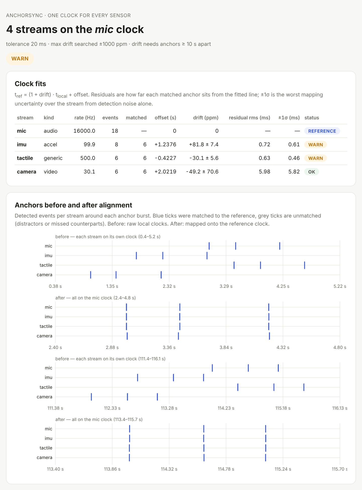

# anchorsync

**Put every sensor stream on one clock.**

[](https://github.com/WayneUSC/anchorsync/actions/workflows/ci.yml)

[](LICENSE)

A multimodal rig — microphone, IMU, tactile array, force sensor, cameras — has as many clocks as devices.
They start at different moments, they run at slightly different speeds, and their timestamps jitter and drop
samples. The usual fix is a clap at the start. That removes the **offset** but not the **drift**: a 50 ppm crystal
mismatch, ordinary for consumer hardware, adds 180 ms per hour — five video frames, or the whole contact phase of a
grasp.

`anchorsync` uses a few taps at the start **and** at the end of a recording (the *dual-anchor* protocol):

1. **detects** the taps in every stream — audio, accelerometers, force/tactile arrays, camera motion energy;
2. **matches** them across streams, robust to missed taps, footsteps, handling bumps and offsets of hours;
3. **fits** offset *and* drift per clock onto a reference, with standard errors;
4. **checks** each stream's own timestamps — dropouts, jitter, time running backwards, wrong nominal rate;
5. **resamples** everything onto one timeline (CSV/Parquet/DataFrame), ready for training or a LeRobot dataset.

<picture>
  <source media="(prefers-color-scheme: dark)" srcset="docs/assets/report-dark.png">
  
</picture>

## Install

```bash
pip install "git+https://github.com/WayneUSC/anchorsync"
pip install "anchorsync[video] @ git+https://github.com/WayneUSC/anchorsync"   # + video files via OpenCV
```

Python 3.10+, NumPy, SciPy, pandas.

## 30-second demo

```bash
anchorsync demo --html sync.html          # taps at start and end
anchorsync demo --single                  # only at the start: see the drift you are left with
```

A synthetic two-minute session with known clocks: mic (16 kHz, reference, hears footsteps), IMU (100 Hz, host
timestamps with jitter, +80 ppm), 16-taxel tactile array (500 Hz, 0.5 % dropped samples, −35 ppm), camera motion
energy (30 fps, +15 ppm).

| worst alignment error over 2 min | taps at start only | taps at start + end |
|---|---|---|
| IMU (+80 ppm) | 9.8 ms | **0.5 ms** |
| tactile (−35 ppm) | 3.2 ms | **0.9 ms** |
| camera (30 fps) | 17 ms | 17 ms — bounded by the 33 ms frame period |

The start-only error grows linearly with recording length: the IMU above would be **288 ms** off after an hour.

## Use it

### Python

```python
from anchorsync import Stream, SyncSession

sess = SyncSession(reference="mic")
sess.add(Stream.from_wav("mic.wav", name="mic"))
sess.add(Stream.from_csv("phone_imu.csv", name="imu", kind="accel"))           # Phyphox export works as is
sess.add(Stream.from_csv("tactile.csv", name="tactile", time="t_ms", time_unit="ms"))
sess.add(Stream.load("top_cam.mp4", name="cam", roi=(200, 120, 160, 160)))     # motion energy in the tap area

result = sess.fit()
print(result.summary())
result.to_html("sync.html")
result.save("fits.json")                   # re-apply later with anchorsync.load_fits()

frames = result.resample(rate=30, method="linear")   # pandas DataFrame on the mic clock
```

```text
reference clock: mic
stream         events  matched   offset (s)      drift (ppm)  rms (ms)  ±1σ (ms)  status
----------------------------------------------------------------------------------------
mic                18        -       0.0000                0         -         -  reference
imu                 8        6      +1.2376      +81.8 ± 7.4      0.72      0.61  warn
tactile             6        6      -0.4227      -30.1 ± 5.6      0.63      0.46  warn
camera              6        6      +2.0219     -49.2 ± 70.6      5.98      5.82  ok

notes:
  imu: timing — jitter 1.42 ms is 14% of the 10.01 ms period
  tactile: timing — 324 gaps (> 3.0 ms), ~648 ms missing, largest 2.0 ms
```

The camera line is a useful reminder: at 30 fps each tap is only known to within a frame, so its drift estimate
carries ±70 ppm. Tap more often, use a higher frame rate, or use a flash with `signal="brightness"`.

### Command line

```jsonc
// sync.json — paths are relative to this file
{
  "reference": "mic",
  "tolerance_ms": 20,
  "streams": [
    {"name": "mic",     "path": "mic.wav"},
    {"name": "imu",     "path": "imu.csv",     "kind": "accel", "nominal_rate": 100},
    {"name": "tactile", "path": "tactile.tsv", "time": "t_ms", "time_unit": "ms", "min_strength": 15},
    {"name": "cam",     "path": "top.mp4",     "roi": [200, 120, 160, 160]}
  ]
}
```

```bash
anchorsync fit sync.json --html sync.html --json fits.json --resample 30 --out aligned.parquet
anchorsync check imu.csv --rate 100        # timing health of one file
anchorsync detect imu.csv --kind accel     # what anchors does it see?
```

TOML configs work too (`sync.toml`).

### Into a LeRobot dataset

`resample()` gives one row per frame on the reference clock; feed it to your recorder:

```python
frames = result.resample(rate=dataset.fps, method="previous")   # zero-order hold for states
for _, row in frames.iterrows():
    dataset.add_frame({"observation.tactile": row.filter(like="tactile.").to_numpy("float32"), ...})
```

## Recording protocol

1. Start every recorder.
2. **Tap the rig three times** with irregular spacing (tap – tap — tap) somewhere every sensor feels it: the
   table, the gripper, the object. Make sure a camera sees it.
3. Record.
4. **Tap three times again** before stopping.

Irregular spacing prevents the matcher from locking onto a shifted copy of the pattern. Ten seconds or more between
the two bursts is needed to estimate drift; the longer the better.

## How it works

| Step | Method |
|---|---|
| activity envelope | audio: \|Δx\| max-pooled to ≤ 4 kHz and smoothed; accelerometer: jerk magnitude; arrays: Σ\|Δx\| with each channel scaled by its own noise; video: per-frame motion energy or brightness |
| detection | threshold at median + 12 MAD, refractory merge, **constant-fraction onset** (first crossing of 25 % of the event's own peak, interpolated) so loud and soft taps are timed alike; midpoint rule for one-frame video spikes |
| matching | vote over all event pairings for the offset (tolerance widened for the largest allowed drift), then ICP-style refinement: one-to-one mutual-nearest matching ↔ least-squares line, until stable |
| model | t<sub>ref</sub> = (1 + drift) · t<sub>local</sub> + offset; drift only when matched anchors span ≥ 10 s, otherwise offset-only with a warning |
| uncertainty | parameter covariance from residuals, floored at each stream's detection limit (a tenth of a sample period; one frame / √12 for video) |
| timing health | jitter-aware dropout detection, non-monotonic and duplicate timestamps, effective vs nominal rate |
| resampling | linear / nearest / zero-order hold onto a uniform grid; samples across a dropout become NaN instead of being interpolated |

Constant sensor latencies (filter delay, exposure timing, USB buffering) look like offset and are absorbed into it;
they are only separable with a hardware reference.

## Part of a small toolkit for trustworthy robot data

| | Question |
|---|---|
| [**shortcut-audit**](https://github.com/WayneUSC/shortcut-audit) | Can a model cheat on your dataset? |
| **anchorsync** | Are your sensor streams actually on the same clock? |
| [**rollout-stats**](https://github.com/WayneUSC/rollout-stats) | Is your policy's improvement real, or 20 lucky rollouts? |

## Citation

```bibtex
@software{chen_anchorsync_2026,
  author = {Chen, Wen},
  title  = {anchorsync: anchor-based clock alignment for multimodal sensor recordings},
  year   = {2026},
  url    = {https://github.com/WayneUSC/anchorsync}
}
```

## License

Apache-2.0
